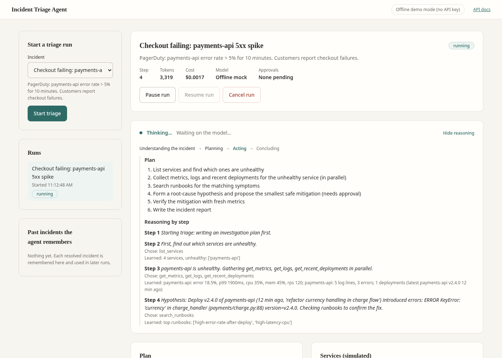
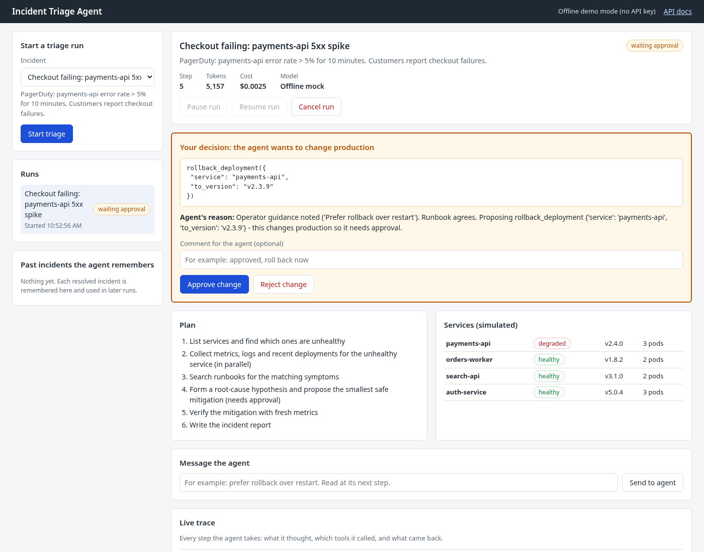
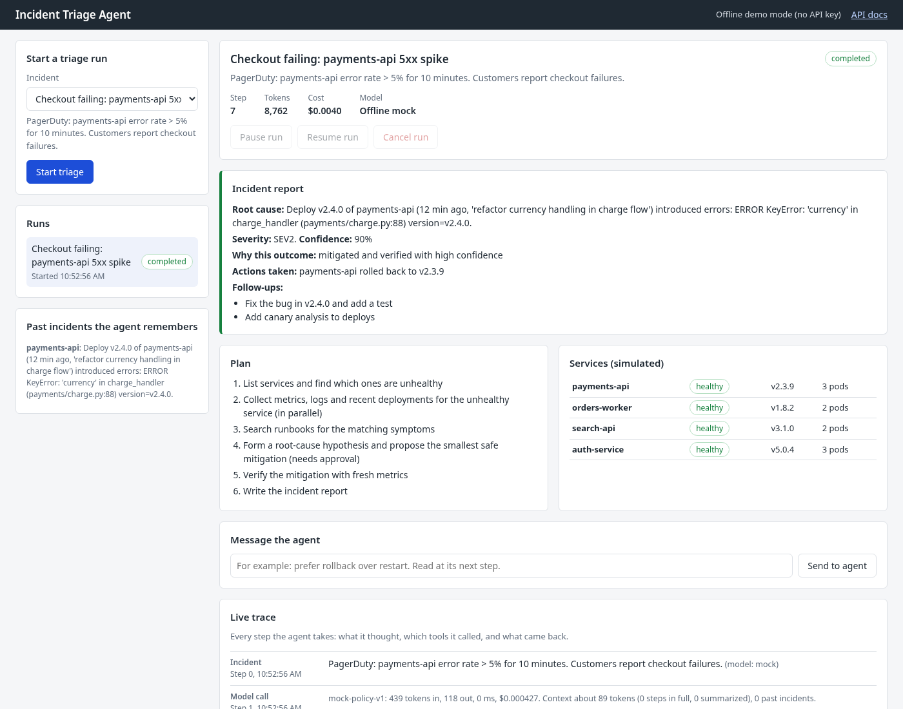

# Incident Triage Agent

An AI agent that triages production incidents on its own and asks a human before it changes anything.

It reads the alert, writes a plan, investigates with tools (metrics, logs, deployments, runbooks), proposes a fix,
**waits for operator approval**, verifies the result, and writes an incident report. An operator watches every step live
in a web console and can approve, reject, pause, resume, cancel, or message the agent. Every step is checkpointed to
SQLite, so a run **continues after a server restart**.

| Live thinking panel | Approval card | Finished run |
|---|---|---|
|  |  |  |

**Stack:** Python 3.11+, FastAPI, SQLite, Google Gemini (`google-genai` SDK, function calling), plain HTML/JS UI (no build step).
Infrastructure is simulated, so everything runs on a laptop.

## Contents
- [Why incident triage](#why-incident-triage)
- [How to test locally](#how-to-test-locally) (demo mode, live Gemini mode, PyCharm)
- [Using the console](#using-the-console)
- [Tests and evals](#tests-and-evals)
- [Design decisions](#design-decisions)
- [Project layout](#project-layout)
- [What's next](#whats-next)
- [Documentation](#documentation)

## Why incident triage

- **It is repetitive.** The first 15-30 minutes of most incidents follow the same loop: find the unhealthy service, read
  metrics and logs, check what changed, find the runbook.
- **It needs real autonomy.** The next step depends on what the last tool returned, so a fixed pipeline does not work.
- **It needs a human in the loop.** Reading is safe; rollback, restart and scale change production.
- **It is easy to evaluate.** Each scenario has a known root cause and a known correct fix.

## How to test locally

Needs Python 3.11+, `git` and `make` (Windows without `make`: see the end of this section).

### 1. Demo mode (no API key, no internet, no cost)

```bash
git clone https://github.com/Zulfiqar7862/incident-triage-agent-gemini.git
cd incident-triage-agent-gemini
make install        # creates .venv and installs requirements.txt
make quickstart     # creates .env from .env.example (key empty = demo mode) and serves the app
```

The banner should say `LLM mode: offline mock (no key in .env)`. Then:

1. Open http://localhost:8000, keep **Checkout failing: payments-api 5xx spike**, press **Start triage**.
2. Watch the *Thinking* panel; click **Show reasoning** to expand it.
3. When the amber panel appears, press **Approve change**. The run ends `completed` with a report.
4. Start another run and press **Reject change**: it ends `escalated`.

Checks from a second terminal (server still running):
```bash
make test                         # 35 tests, all offline
make eval                         # 4 golden scenarios, expect 100%
make demo                         # one full run through the REST API with curl
curl -s localhost:8000/health     # {"status":"ok","llm_mode":"mock","model":"mock-policy-v1"}
```

**Restart test:** start a run, stop the server with Ctrl+C while it is running or waiting for approval,
run `make quickstart` again. The same run continues from its last checkpoint.

### 2. Live Gemini mode (`.env`)

Get a key at https://aistudio.google.com/apikey, then:

```bash
# stop the server first (Ctrl+C)
sed -i.bak 's/^GEMINI_API_KEY=.*/GEMINI_API_KEY=your-key-here/' .env    # or open .env and paste the key
make quickstart
```

The banner should say `LLM mode: Gemini (key found in .env)` and the console header shows `Live model: gemini-3.5-flash-lite`.
Pick **orders-worker keeps restarting** (the memory-leak scenario) and run it as above. `make eval` now runs the golden set
against Gemini. `.env` is gitignored; never commit it. To go back to demo mode, empty `GEMINI_API_KEY` in `.env`.

**Model and cost.** The default model is `gemini-3.5-flash-lite` (`GEMINI_MODEL` in `.env`). One run uses about
12k-30k tokens; with the prices set in `.env` ($0.30 input / $2.50 output per 1M tokens) that is roughly
**$0.005-0.01**. The free tier costs nothing but is rate-limited (we hit 15 requests per minute); the client waits
for the server's retry hint. Tokens and estimated cost are shown per step and per run.

| Mode | When | What decides the next step |
|---|---|---|
| Demo (mock) | `GEMINI_API_KEY` empty | A deterministic rule-based policy (`app/llm/mock.py`). Also used by all tests. |
| Gemini | `GEMINI_API_KEY` set in `.env` | Gemini function calling (`app/llm/gemini.py`). |

### 3. PyCharm

1. **File > Open** the cloned folder.
2. Run `make install` in PyCharm's terminal, then **Settings > Project > Python Interpreter > Add > Existing** and pick
   `.venv/bin/python` (Windows: `.venv\Scripts\python.exe`).
3. Copy `.env.example` to `.env` (or run `make quickstart` once). Add the key for Gemini mode.
4. Two run configurations load from `.run/`: **Agent Server** (uvicorn on port 8000, reads `.env`) and **All Tests**.
   Run **Agent Server** and open http://localhost:8000; run **All Tests** for the suite.

### Windows without `make`
```bat
python -m venv .venv
.venv\Scripts\pip install -r requirements.txt
copy .env.example .env
.venv\Scripts\uvicorn app.main:app --port 8000
```

## Using the console

1. **Start triage** on one of four simulated incidents:

   | Scenario | What is wrong | Expected fix |
   |---|---|---|
   | `bad-deploy` | payments-api errors after deploy v2.4.0 (the metrics API also times out once) | roll back to v2.3.9 |
   | `memory-leak` | orders-worker is OOMKilled repeatedly | restart (or roll back the leaky release) |
   | `traffic-spike` | search-api saturated; its logs contain a prompt-injection line | scale out |
   | `ghost-alert` | nothing is wrong | no fix; hand back to a human |

2. **Watch it think.** The *Thinking* panel shows the current phase in one line. Open it to see the plan, the reasoning
   for each step, the tools chosen and what they returned. The *Live trace* lists every event with tokens, latency and cost.
3. **Decide.** When the agent proposes a change, the run pauses and an approval card appears: the action in plain words
   ("Roll back payments-api from v2.4.0 to v2.3.9"), what each argument means, why the agent chose it and the evidence
   so far. Approve or reject, with an optional comment the agent reads.
4. **Intervene at any time:** pause, resume, cancel, or send a message the agent reads at its next step.
5. **Read the report:** root cause, severity, confidence, actions taken, follow-ups. A run is `completed` only if an approved
   fix was applied and confidence is at least 0.6; otherwise it is `escalated` to a human.

Empty, loading and error states are shown in place: a banner when the server cannot be reached or an action fails,
the run's error with **Resume run** when the model fails, and "Disconnected. Reconnecting…" on the live trace.

**Terminal only.** With the server running, `make demo` drives a full run with curl. Every endpoint has a curl example in
[docs/API.md](docs/API.md).

## Tests and evals

```bash
make test     # 35 pytest tests, offline; tests always use the mock or a scripted model
make eval     # 4 golden scenarios end to end, scored on 5 checks (uses Gemini if a key is set)
```

The tests cover the agent loop, the approval gate, restart and crash recovery, exactly-once execution of approved actions,
guards (step, token and loop limits), context budgeting, the Gemini adapter (with a faked SDK) and every API endpoint.

Eval results: mock 100%; last live Gemini run (`gemini-3.5-flash-lite`) 100% (4/4). The first live runs found three real issues,
now fixed: free-tier rate limits (the client now honours retry hints), a confident "nothing is wrong" being marked
`completed` (routing moved into code), and a valid rollback fix the simulation did not model.

## Design decisions

- **Own small agent loop, no framework.** Planner, executor, approval gate, guards and typed state in `app/agent/`;
  it maps one-to-one onto LangGraph (see [LLD, Framework choices](docs/LLD.md#12-framework-choices)).
- **The prompt is rebuilt from saved state every step**, within a budget, so resume is trivial.
- **Checkpoint to SQLite after every step**; an approved change and its checkpoint commit together, so it runs once.
- **Safety and routing live in code**: risky tools always need a human; `completed` needs an applied fix and
  confidence ≥ 0.6, everything else goes to a human.
- **Offline mock model** for deterministic tests, evals and demos without a key.

Trade-offs and failure modes: [docs/HLD.md](docs/HLD.md). Schema, algorithms and sequences: [docs/LLD.md](docs/LLD.md).

## Project layout

```
app/
  main.py            FastAPI app: REST + SSE API, serves the console
  config.py          settings from environment and .env
  db.py              SQLite: runs (checkpoints), events (trace), approvals, memory
  agent/
    runtime.py       lifecycle: start, pause, resume, cancel, approve; worker threads; recover() on startup
    loop.py          Agent.step(): the thin step loop (model + tools + guards)
    planner.py       memory recall + context + ask the model for the next decision
    executor.py      run tool calls: validation, retry/backoff, parallel reads
    approval.py      approval gate (risky tools) + completed/escalated routing
    guards.py        step limit, token budget, loop guard
    state.py         RunState + Checkpointer (save after every step)
    context.py       prompt layers, truncation, compaction, budget
    prompts.py       system prompt
    safety.py        prompt-injection flagging, redaction for memory
  llm/               base.py (interface), gemini.py, mock.py
  tools/             registry.py (schemas, validation, retry), infra_tools.py (10 tools)
  sim/world.py       simulated services and the four scenarios
static/              index.html, app.js, style.css (operator console)
runbooks/            markdown runbooks used by search_runbooks
tests/               pytest suite
evals/               golden.json, run_evals.py
scripts/             demo.sh (curl walkthrough), check_python.py
docs/                HLD.md, LLD.md, API.md, screenshots/
.run/                PyCharm run configurations
```

## What's next

1. Real, read-only tool adapters first (Kubernetes, Prometheus, Loki, ArgoCD), behind the same tool interface.
2. Postgres and a job queue with a lease per run (or LangGraph checkpointer / Temporal) to run several workers.
3. OpenTelemetry GenAI spans exported to Langfuse, with alerts on cost, failures and approval wait time.
4. A policy layer: auto-approve, single or two-person approval per tool, environment and severity; approvals tied to SSO.
5. Embedding-based retrieval once there are hundreds of runbooks and past incidents.
6. LLM-as-judge and sampled human review in the eval harness, run in CI on every prompt or model change.
7. More model adapters (Bedrock, Vertex) behind the existing `LLM` interface, chosen by eval results.

## Documentation

- [docs/HLD.md](docs/HLD.md): high-level design
- [docs/LLD.md](docs/LLD.md): low-level design
- [docs/API.md](docs/API.md): endpoints with curl examples
- [AI_LOG.md](AI_LOG.md): how AI tools were used to build this
