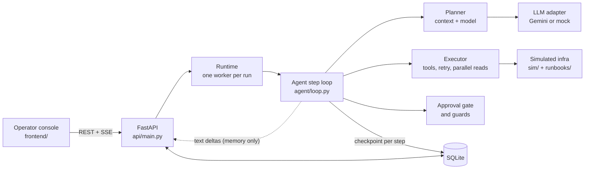

# Incident Triage Agent

An AI agent that triages production incidents on its own and asks a human before it changes anything.

## Overview

When an alert fires, the agent:

1. **Plans.** It writes a short numbered plan, shown in the console before any tool runs.
2. **Investigates.** It calls tools (service list, metrics, logs, deployments, runbooks), several at once when it can,
   and its reasoning streams into the console as it is written.
3. **Proposes a fix and waits.** Rollback, restart and scale change production, so the run stops and an approval card
   appears. The operator approves or rejects, with an optional comment the agent reads.
4. **Verifies and answers.** After an approved change it checks the metrics again, then writes the answer
   (diagnosis, action taken, outcome, confidence) with its sources and a list of what was done and not done.

Every step is checkpointed to SQLite, so a run continues after a server restart. A run is `completed` only when an
approved fix was applied and confidence is at least 0.6; anything else is `escalated` to a human.

**Stack:** Python 3.11+, FastAPI, SQLite, Google Gemini (`google-genai`, function calling, streaming), and a
plain HTML/CSS/JS console with no build step. The infrastructure is simulated, so everything runs on a laptop.

## Contents

- [Setup (local dev)](#setup-local-dev)
- [Using the console](#using-the-console)
- [Use case rationale](#use-case-rationale)
- [Architecture](#architecture)
- [Design decisions](#design-decisions)
- [Project structure](#project-structure)
- [Testing and evals](#testing-and-evals)
- [Engineering practices](#engineering-practices)
- [How this meets the brief](#how-this-meets-the-brief)
- [Limitations](#limitations)
- [What's next](#whats-next)
- [Documentation](#documentation)

## Setup (local dev)

You need Python 3.11+, `git` and `make`. On Windows without `make`, see the commands at the end of this section.

### Demo mode (no API key, no internet, no cost)

```bash
git clone https://github.com/Zulfiqar7862/incident-triage-agent-gemini.git
cd incident-triage-agent-gemini
make install        # creates .venv and installs the package with dev tools (pip install -e ".[dev]")
make quickstart     # creates .env from .env.example (key empty = demo mode) and serves on port 8000
```

The terminal prints `LLM mode: offline mock (no key in .env)`. Open http://localhost:8000 and follow
[Using the console](#using-the-console). In demo mode a deterministic rule-based policy
(`src/incident_triage_agent/llm/mock.py`) decides each step. The tests and CI use the same policy.

From a second terminal, with the server still running:

```bash
make test                         # 48 tests, offline
make eval                         # 4 golden scenarios end to end, expect 100%
make demo                         # one full run through the REST API with curl
curl -s localhost:8000/health     # {"status":"ok","llm_mode":"mock","model":"mock-policy-v1"}
```

**Restart check:** start a run, stop the server with Ctrl+C while the run is working or waiting for approval, then run
`make quickstart` again. The same run continues from its last checkpoint.

### Gemini mode

Get a key at https://aistudio.google.com/apikey, stop the server, and put the key in `.env`:

```bash
sed -i.bak 's/^GEMINI_API_KEY=.*/GEMINI_API_KEY=your-key-here/' .env    # or edit .env by hand
make quickstart
```

The terminal prints `LLM mode: Gemini (key found in .env)` and the run header shows the model. `.env` is gitignored.
To return to demo mode, clear `GEMINI_API_KEY`.

**Model and cost.** The default model is `gemini-3.5-flash-lite` (`GEMINI_MODEL`). A run uses about 12k-30k tokens,
roughly $0.005-0.01 at the prices in `.env.example` ($0.30 input and $2.50 output per 1M tokens). The free tier is
rate-limited; the client waits for the server's retry hint. Tokens and estimated cost are shown per run.
Note that `make eval` uses Gemini when a key is set.

### Settings

All settings live in `.env` (see `.env.example`). The ones you are most likely to change:

| Variable | Default | Effect |
|---|---|---|
| `GEMINI_API_KEY` | empty | Empty runs the offline demo policy; set runs Gemini |
| `GEMINI_MODEL` | `gemini-3.5-flash-lite` | Model used in Gemini mode |
| `STEP_DELAY_SECONDS` | `0.8` | Pause between steps so a person can follow along (0 = full speed) |
| `STREAM_DELAY_SECONDS` | `0.03` | Pause between streamed text chunks in the console |
| `MIN_CONFIDENCE` | `0.6` | Below this, a finished run is escalated to a human |
| `MAX_STEPS`, `MAX_RUN_TOKENS` | `15`, `200000` | Hard limits per run |

### PyCharm

1. Open the cloned folder, run `make install` in the terminal, and set the interpreter to `.venv/bin/python`
   (Windows: `.venv\Scripts\python.exe`).
2. Two run configurations load from `.run/`: **Agent Server** (uvicorn on port 8000, reads `.env`) and **All Tests**.

### Windows without `make`

```bat
python -m venv .venv
.venv\Scripts\pip install -e ".[dev]"
copy .env.example .env
.venv\Scripts\uvicorn incident_triage_agent.api.main:app --port 8000
```

## Using the console

The console is a single conversation column with the list of runs on the left.

1. **Start.** Pick an incident in the composer and press **Start triage**. You can also type your own alert text.

   | Scenario | What is wrong | Expected fix |
   |---|---|---|
   | `bad-deploy` | payments-api errors after deploy v2.4.0; the metrics API also times out once | Roll back to v2.3.9 |
   | `memory-leak` | orders-worker is OOMKilled repeatedly | Restart, or roll back the leaky release |
   | `traffic-spike` | search-api is saturated; its logs contain a prompt-injection line | Scale out |
   | `ghost-alert` | Nothing is wrong | No fix; hand back to a human |

2. **Plan.** The plan appears first as a numbered list and stays visible. If the agent revises it, the list updates.
3. **Thinking.** The agent's reasoning for each step streams in as it is written, labelled with the step number.
4. **Acting.** Each tool call is a row: what it does, its arguments, and its status (running, done, failed, or waiting
   for you).
5. **Approve or reject.** A change to production opens an approval card in place. It states the action in plain words
   ("Roll back payments-api from v2.4.0 to v2.3.9"), what each argument means, why the agent chose it, and the evidence
   so far. After you decide, the card becomes a one-line receipt.
6. **Result.** The answer streams in as a short document: diagnosis, action taken, outcome, confidence and follow-ups.
   Below it are the **sources** (which tool produced each finding, at which step) and **done / not done**.

At any time you can pause, resume or cancel, or type a message to the agent (Enter sends). The agent reads the message at
its next step. Errors show in place: a banner when the server cannot be reached, and the run's error with **Resume run**
when the model fails. Every endpoint has a curl example in [docs/API.md](docs/API.md).

## Use case rationale

Incident triage is a good fit for an autonomous agent with a human in the loop:

- **It is repetitive.** The first 15-30 minutes of most incidents follow the same loop: find the unhealthy service, read
  metrics and logs, check what changed, find the runbook.
- **It needs real autonomy.** Which tool to call next depends on what the last one returned, so a fixed pipeline does
  not work.
- **It needs a human.** Reading is safe; rollback, restart and scale change production and must be approved.
- **It is measurable.** Each scenario has a known root cause and a known correct fix, so the agent can be scored.

## Architecture



Each step the agent loads its checkpoint, rebuilds the prompt from saved state, asks the model for the next tool
calls, runs safe reads in parallel, sends risky calls to the approval gate, and saves a new checkpoint. Final events
(plan, thought, tool results, answer) go to the `events` table and reach the console over Server-Sent Events. Text
deltas are kept in memory only and stream ahead of their final event. Details: [docs/HLD.md](docs/HLD.md) and
[docs/LLD.md](docs/LLD.md).

## Design decisions

- **Planning.** The first step can only call `update_plan`, so every run starts with a short visible plan (the tool asks for 3-6 steps). The
  agent can revise it later, and revisions are recorded as `plan_revised`.
- **Tool use.** There are ten JSON-schema tools: five reads, three risky writes, and two control tools (`update_plan`,
  `finish_triage`). Arguments are validated before a tool runs. Reads in the same step run in parallel. Tool output is
  truncated and treated as untrusted data.
- **Error recovery.** Transient tool errors are retried with exponential backoff. Bad arguments come back as an
  observation with hints, so the model can correct itself. Step limits, a token budget and a loop guard stop runaway
  runs. A model outage marks the run `failed`, and it can be resumed from its checkpoint.
- **Human in the loop.** The risky flag is enforced in code, not in the prompt, so a prompt injection cannot skip
  approval. One risky action per turn. Rejections and comments are fed back to the agent. Routing is also in code:
  `completed` needs an applied fix and confidence ≥ 0.6.
- **Resumable state.** The run is checkpointed to SQLite after every step, and `recover()` restarts interrupted runs on
  startup. An approved action and its checkpoint commit in one transaction, so the action runs exactly once.
- **Operator UI.** Plain JS with no build step. Order of the page: plan, thinking, acting, result. The plan is never
  collapsed. Streaming shows progress without storing per-token data.
- **Backend API.** REST endpoints expose the runtime (start, pause, resume, cancel, approve, guide), the tools
  (`/api/tools`), and the state (run view, trace events, memory). SSE carries live events. OpenAPI docs are at `/docs`.
- **No agent framework.** The loop is small enough to read in one sitting and maps one-to-one onto LangGraph
  ([LLD, framework choices](docs/LLD.md#12-framework-choices)).

**Trade-offs.** SQLite and worker threads keep setup at zero but limit the service to one process. Keyword runbook
search is precise for four runbooks but will not scale to hundreds. Rebuilding the prompt every step re-sends a
summary each time, which costs a little in exchange for trivial resume and a bounded context. The full table is in
[HLD section 4](docs/HLD.md#4-design-decisions-and-trade-offs).

## Project structure

```
src/incident_triage_agent/   the Python package (installed editable by make install)
  api/          FastAPI app: REST and SSE endpoints, serves the console
  agent/        runtime, step loop, planner, executor, approval gate, guards, state, streaming, answer, sources
  llm/          model adapters behind one interface: Gemini and the offline mock
  tools/        tool registry (schemas, validation, retry) and the infrastructure tools
  sim/          simulated services and the four incident scenarios
  config.py     settings from the environment and .env
  db.py         SQLite storage: runs (checkpoints), events (trace), approvals, memory
frontend/       operator console: index.html, app.js, style.css
runbooks/       markdown runbooks the agent searches
tests/          pytest suite, one folder per package area (agent, api, llm, tools)
evals/          golden scenarios and the scoring harness
scripts/        demo.sh: a full run through the REST API with curl
docs/           HLD, LLD and API reference
.run/           two PyCharm run configurations (server, tests)
.github/        CI workflow
```

## Testing and evals

```bash
make test     # 48 pytest tests, offline; tests use the mock or a scripted model, never a real key
make lint     # ruff
make eval     # 4 golden scenarios end to end, 5 checks each
```

The tests cover the agent loop, the approval gate, restart and crash recovery, exactly-once execution of approved
actions, guards (step, token and loop limits), context budgeting, the plan and answer events, streaming (deltas join
to the saved text, plan before answer), the sources and done/not-done summary, the Gemini adapter (with a faked SDK),
and every API endpoint.

The evals drive each scenario with an automatic operator that approves only the expected action. They score status,
proposed action, root-cause keywords, step budget, and "no unapproved change". Mock mode scores 100%. The last full
live run on `gemini-3.5-flash-lite` scored 100% (4/4). The first live runs found three real issues, all now fixed:
free-tier rate limits (the client now honours retry hints), a confident "nothing is wrong" being marked `completed`
(routing moved into code), and a valid rollback fix the simulation did not model.

## Engineering practices

- `pyproject.toml` is the single config: dependencies, src-layout packaging, pytest and ruff settings.
- CI (`.github/workflows/ci.yml`) runs ruff, pytest and the evals in mock mode on Python 3.11 and 3.13, with no secrets.
- `.pre-commit-config.yaml` runs ruff and basic file checks, including private-key detection, before each commit.
- `.editorconfig` keeps indentation and line endings consistent across editors.

## How this meets the brief

| Requirement | Where |
|---|---|
| Autonomous multi-step agent | `agent/loop.py` (one step per call), `agent/runtime.py` (worker loop) |
| Planning | `update_plan` forced first (`agent/planner.py`); plan always shown in the console |
| Tool use | `tools/registry.py`, `tools/infra_tools.py`; parallel reads in `agent/executor.py` |
| Error recovery | retries in `tools/registry.py`; `agent/guards.py`; resumable `failed` status |
| Human in the loop | `agent/approval.py`; approval card in `frontend/`; `POST /api/runs/{id}/approval` |
| Resumable state | checkpoint per step in `agent/state.py` and `db.py`; `Runtime.recover()` |
| Operator UI | `frontend/`: plan, streamed thinking, acting, approval, answer, sources |
| Backend API exposing runtime, tools and state | `api/main.py`; reference in `docs/API.md`; OpenAPI at `/docs` |
| Observability | `events` table, tokens and cost per run, SSE `trace` and `token` events |
| Evaluation | `evals/golden.json`, `evals/run_evals.py`, run in CI |
| Setup, rationale, design decisions, what's next | this README; `docs/HLD.md`, `docs/LLD.md` |

## Limitations

- The infrastructure is simulated. The tools never touch a real cluster.
- One process: SQLite and in-process worker threads. Token deltas are in memory, so a client that connects after a
  step finished sees only the saved text, not the stream.
- No authentication. Anyone who can reach the server can approve a change.
- Runbook search is keyword-based. There are only four scenarios and four runbooks.
- The mock policy is rule-based and exists for demos and tests. It is not a model.

## What's next

1. Real, read-only tool adapters first (Kubernetes, Prometheus, Loki, ArgoCD), behind the same tool interface.
2. Postgres and a job queue with a lease per run (or a LangGraph checkpointer or Temporal) so several workers can run.
3. SSO and per-tool approval policy: auto-approve, single or two-person approval by environment and severity.
4. OpenTelemetry GenAI spans exported to a tracing backend, with alerts on cost, failures and approval wait time.
5. Embedding-based retrieval once there are hundreds of runbooks and past incidents.
6. LLM-as-judge and sampled human review in the eval harness, run in CI on every prompt or model change.

## Documentation

- [docs/HLD.md](docs/HLD.md): goals, components, data flow, state and recovery, safety, scaling
- [docs/LLD.md](docs/LLD.md): modules, classes, events, database schema, routing, error handling
- [docs/API.md](docs/API.md): every endpoint with request and response examples, and the SSE events
