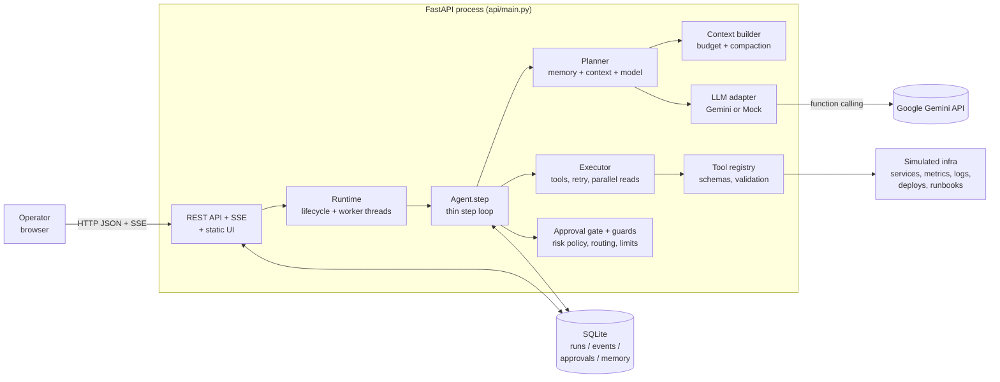
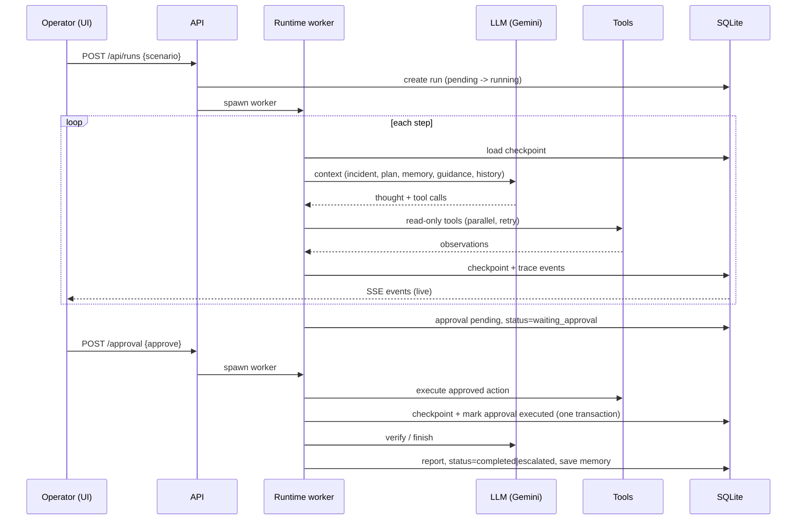

# High-Level Design (HLD) - Incident Triage Agent

## 1. Problem
When an alert fires, an on-call engineer repeats the same loop: find the sick service, read metrics and
logs, check what changed, find the runbook, apply a fix, verify. It is slow at 3 a.m. and error-prone.
**Goal:** an agent that does this loop on its own, but **never changes production without a human**, shows
its reasoning live, and **does not lose work** if the server restarts.

### Functional requirements
| # | Requirement | Where |
|---|---|---|
| F1 | Plan, then act step by step with tools; revise the plan when evidence changes | `agent/loop.py`, `agent/planner.py`, `update_plan` tool |
| F2 | Recover from tool errors (retry transient, self-correct on permanent) | `tools/registry.py`, loop notes |
| F3 | Human approval for every mutating action; approve/reject with comment | `agent/approval.py`, `/approval` API, UI card |
| F4 | Start / pause / resume / cancel runs | `agent/runtime.py` |
| F5 | Resume after process restart from the last checkpoint | `db.save_checkpoint`, `Runtime.recover()` |
| F6 | Operator sees plan, thoughts, tool calls, results, tokens, cost, latency live | events table + SSE + UI |
| F7 | Operator can send guidance mid-run | `/guidance` API, context layer |
| F8 | Structured final report + routing to a human when confidence < 0.6 or nothing was mitigated | `finish_triage`, `approval.route()` |
| F9 | Long-term memory of past incidents | `memory` table |

### Non-functional requirements
- Runs locally with one command, no cloud, no Docker; works offline (mock LLM).
- Simple enough to explain end to end; every concept maps to production tools.
- Safe by construction: approval rule in code; tool output treated as untrusted data.
- Observable: every decision is in the trace with tokens / latency / cost.

## 2. Architecture

### Components
| Component | Responsibility | Key idea |
|---|---|---|
| **UI** (`frontend/`) | Start runs, watch the agent think (Thinking panel) and the trace, review changes on a plain-language approval card, pause/resume/cancel, send guidance; empty, loading and error states | Plain JS, SSE for the trace + 1.5 s polling for run state |
| **API** (`src/incident_triage_agent/api/main.py`) | REST endpoints for runtime, tools, state; SSE stream | Thin: validates input, calls Runtime, returns DB state |
| **Runtime** (`agent/runtime.py`) | Lifecycle of runs; one worker thread per active run; `recover()` on startup | Control = conditional status change in DB; worker notices at next step |
| **Agent** (`agent/loop.py`) | Executes exactly one step and checkpoints; a thin loop over the five parts below | Stateless between steps: always starts from DB |
| **Planner** (`agent/planner.py`) | Recalls memory, builds the context, asks the model for the next decision | The only place that talks to the model |
| **Executor** (`agent/executor.py`) | Runs tool calls: schema validation, retry with backoff, parallel reads, injection flag | The only place that runs tools |
| **Approval gate** (`agent/approval.py`) | Turns a risky call into a pending approval; routes a finished run to `completed` or a human | Enforced in code, not in the prompt |
| **Guards** (`agent/guards.py`) | Step limit, token budget, loop guard | Hard limits the model cannot override |
| **State** (`agent/state.py`) | `RunState` and `Checkpointer` | One write per step = durable execution |
| **Context builder** (`agent/context.py`) | Builds the prompt from state in layers within a budget | Truncation + compaction, nothing silently dropped |
| **LLM adapters** (`llm/`) | `decide(context) -> thought + tool calls + usage` | Gemini (function calling) or deterministic mock |
| **Tool registry** (`tools/`) | JSON-schema tools, validation, retry/backoff, risky flag | Errors become observations, never crashes |
| **Simulated infra** (`sim/world.py`) | 4 services, 4 scenarios | World state lives inside the checkpoint |
| **SQLite** (`db.py`) | Checkpoints, trace, approvals, long-term memory | WAL mode, transactions, conditional updates |

## 3. How a run flows (big picture)

## 4. Key design decisions and trade-offs

| Decision | Chosen | Alternative | Why / trade-off |
|---|---|---|---|
| Orchestration | Own small loop (`agent/`: planner, executor, approval gate, guards, state) | LangGraph, Google ADK, Temporal | Fully explainable in a 2-4h timebox. Same concepts (checkpoint per node, interrupt for approval, resume). Would adopt LangGraph/ADK/Temporal for multi-worker production. |
| Conversation state | Rebuild prompt from DB each step | Keep growing chat history in the SDK | Small, deliberate context; resume is trivial; no provider-specific history (e.g. thought signatures). Cost: we re-send the summary every step (cheap at these sizes). |
| Durability | SQLite checkpoint after every step | Event sourcing, Postgres, Temporal | Zero setup, transactional. Single process only - documented as next step. |
| Delivery semantics | Read tools at-least-once; approved actions exactly-once | Exactly-once everywhere | Reads are idempotent, so repeating after a crash is harmless. Writes are protected by marking the approval `executed` in the same transaction as the checkpoint (real infra: approval id as idempotency key). |
| Safety | `risky` flag enforced in code | Ask the model to ask for approval | The model can be tricked; the code cannot. |
| HITL routing | Approval for all writes + confidence threshold | Auto-approve low-risk writes | Simple and safe for a first version. Next: policy per tool / environment. |
| Retrieval | Keyword top-2 runbooks | Embeddings + vector DB | 4 runbooks: keywords are more precise and explainable. Vector search pays off at hundreds of docs. |
| Concurrency | Thread per active run | asyncio / job queue | Gemini SDK + sqlite3 are sync; threads are simplest. Queue + leases when scaling out. |
| UI | Plain HTML/JS + SSE | React | No build step, opens anywhere; the brief judges operator UX, not framework choice. |

## 5. Context engineering (what the model sees, and why)
Rebuilt every step, in priority order: **incident** -> **similar past incidents** (max 3, marked "may be
outdated") -> **plan** -> **operator guidance** (trusted) -> **work so far** (last 4 steps full, older steps
1-line summaries) -> **runtime notes** (errors, rejections, loop-guard) -> **task**.
Budgets: tool output <= 1,500 chars; whole prompt <= 24,000 chars (~6k tokens). If over budget, fewer steps are
shown in full. Per-layer token estimates are logged on every `llm_call` event so you can *see* the budget.
Why small: models get worse as input grows, long before the advertised limit; more context != better reasoning.

## 6. Memory
- **Short-term (working) memory** = the run checkpoint: plan, steps (calls + results), notes, pending action, world.
- **Long-term memory** = `memory` table: one row per affected service of a *confident, completed* run
  (symptom, root cause, resolution). Promotion rule: only `completed` runs (fix applied and confidence >= 0.6) are saved.
  **Redaction** (secrets, emails) before saving. **Staleness**: only memories < 90 days are recalled, max 3,
  and the prompt says "may be outdated - verify".

## 7. Failure modes and how they are handled
| Failure | Handling |
|---|---|
| Tool timeout / 5xx | Retry with exponential backoff (0.3, 0.6, 1.2 s); then error observation to the model |
| Bad tool arguments / unknown service | Validation error returned as observation with hints ("Known services: ..."); model self-corrects |
| Model calls unknown tool / replies without a tool | Observation / runtime note, step counted, loop continues |
| Model loops on the same call | Loop guard blocks a 3rd identical successful call; step limit (15) ends run as `escalated` |
| Token budget exhausted | Run ends `escalated`; 80% budget warning in trace |
| Gemini 429 / 5xx / network | Retries honouring server `retry in Ns`; then run `failed` - **resumable** from checkpoint |
| Server crash mid-step | `recover()` on startup re-runs the step from the last checkpoint |
| Crash after approval, before execution | Approval is still `approved` -> executed on resume, exactly once |
| Prompt injection in logs | Flagged + wrapped as untrusted data; cannot bypass the approval gate |
| Agent finds nothing / unsure | Low confidence -> `escalated` to human, no invented fix |
| Operator rejects action | Rejection + comment fed back; agent adapts or escalates |

## 8. Observability
Every step writes events: `llm_call` (model, tokens in/out, latency, cost, context layer sizes, memories used),
`thought`, `plan`, `tool_call`, `tool_result` (ok, attempts, latency, output), `retry`, `warning`,
`approval_requested/decided`, `guidance`, `status`, `error`, `run_finished`, `memory_saved`, `resumed_after_restart`.
Run totals (tokens, cost) are on the run row. **Production next step:** emit the same data as OpenTelemetry
GenAI spans (run = trace, step = span, LLM/tool = child spans) to Langfuse / Jaeger, with budget alerts.

## 9. Evaluation
`make eval` runs 4 golden scenarios end to end with an automatic operator (approves only the expected action)
and scores: correct status, correct action proposed, root cause keywords, within step budget, no unapproved
change. Results saved to `evals/results/`. Run before/after any prompt or model change.

## 10. Scaling path (what changes in production)
1. SQLite -> Postgres; worker threads -> job queue workers with a lease per run (or Temporal / LangGraph checkpointer).
2. Simulated tools -> real adapters (K8s, Prometheus, Loki, ArgoCD) with least-privilege credentials.
3. SSO + RBAC on approvals, approval expiry, audit log export.
4. OTel tracing, dashboards + alerts on cost/latency/failure rate per agent and per tool.
5. Vector retrieval over runbooks + incident history; LLM-as-judge evals in CI.
