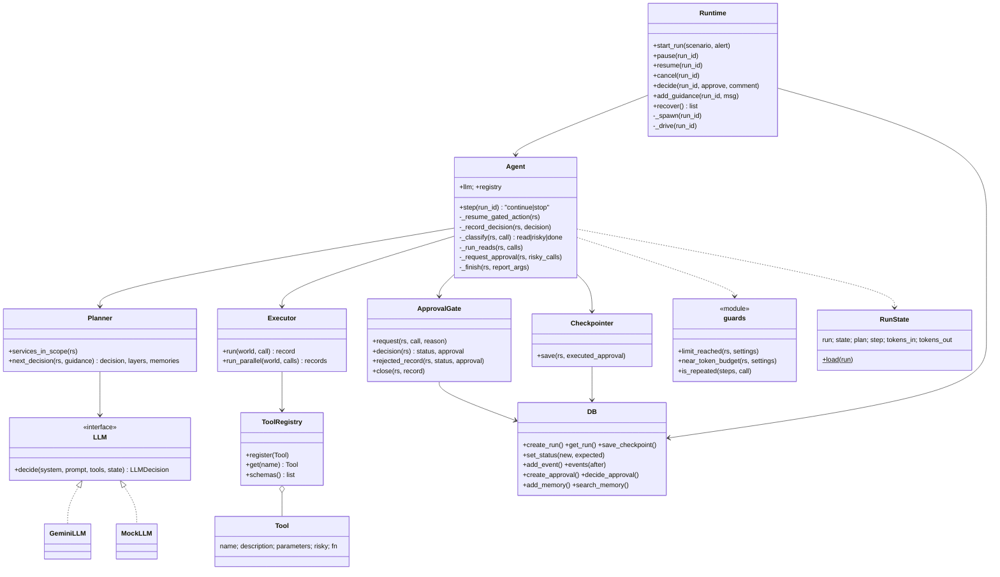
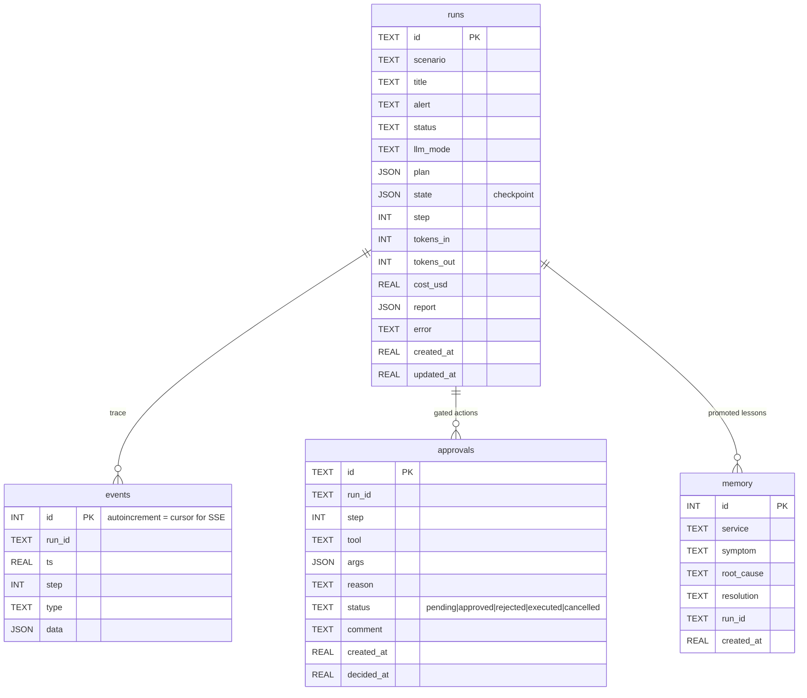
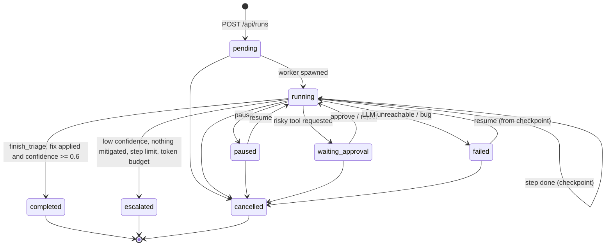
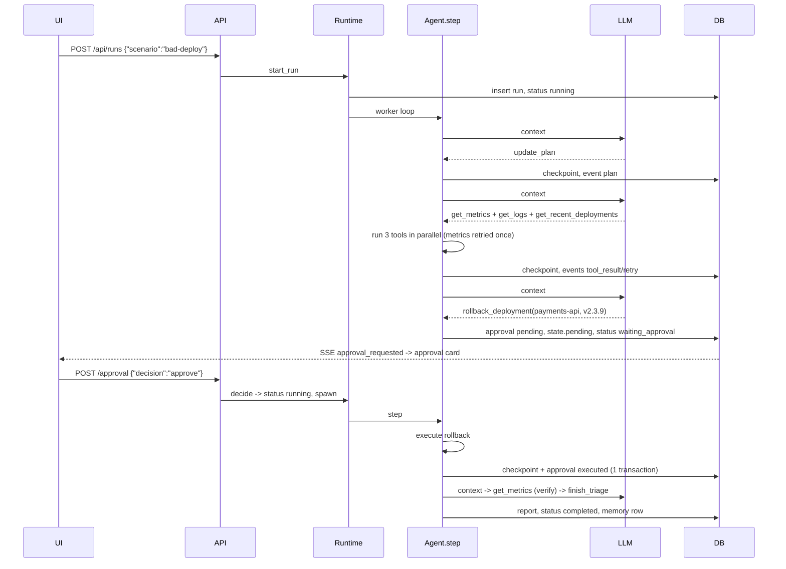
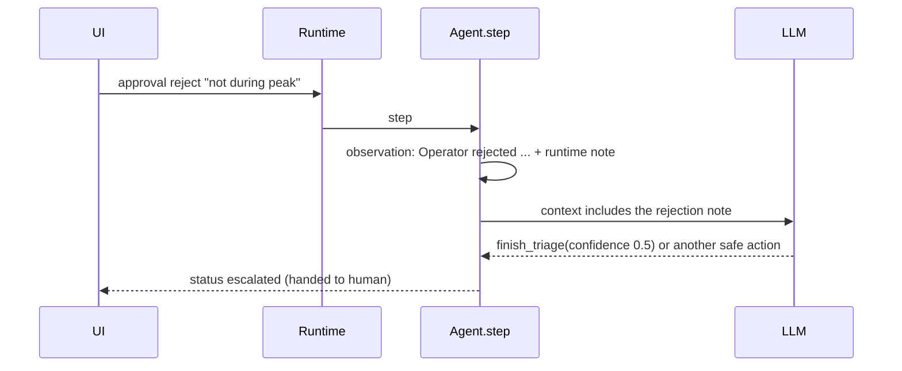
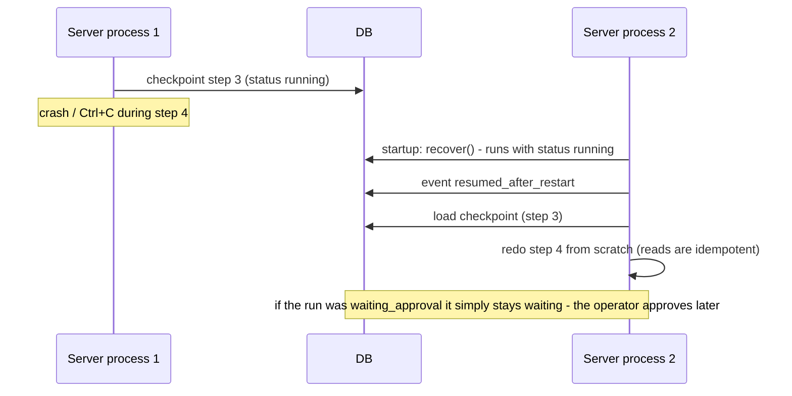

# Low-Level Design (LLD) - Incident Triage Agent

## 1. Module map



| File | Main contents |
|---|---|
| `src/incident_triage_agent/config.py` | `Settings` dataclass (env + `.env` via python-dotenv). `llm_mode` = gemini if key else mock |
| `src/incident_triage_agent/db.py` | `DB` class, schema, conditional status updates, transactions |
| `src/incident_triage_agent/agent/runtime.py` | `Runtime` - lifecycle (start, pause, resume, cancel, decide, guidance), worker threads, `recover()` |
| `src/incident_triage_agent/agent/loop.py` | `Agent.step()` - the thin step loop that calls the modules below |
| `src/incident_triage_agent/agent/state.py` | `RunState` (typed view of a `runs` row), `Checkpointer.save()`, `cost_usd()` |
| `src/incident_triage_agent/agent/planner.py` | `Planner.next_decision()` - memory recall + `build_context()` + `llm.decide()` |
| `src/incident_triage_agent/agent/executor.py` | `Executor.run()` / `run_parallel()` - registry, validation, retry/backoff, injection flag |
| `src/incident_triage_agent/agent/approval.py` | `ApprovalGate` (pending approval, rejected-action record) and `route()` (completed vs escalated) |
| `src/incident_triage_agent/agent/guards.py` | `limit_reached()`, `near_token_budget()`, `is_repeated()` (loop guard) |
| `src/incident_triage_agent/agent/context.py` | `build_context()` -> `(prompt, layer_stats)` |
| `src/incident_triage_agent/agent/prompts.py` | `SYSTEM_PROMPT` |
| `src/incident_triage_agent/agent/safety.py` | `looks_like_injection()`, `redact()` |
| `src/incident_triage_agent/llm/gemini.py` | `GeminiLLM`, `parse_response()`, `retry_delay()` |
| `src/incident_triage_agent/llm/mock.py` | `MockLLM` rule-based policy |
| `src/incident_triage_agent/tools/registry.py` | `Tool`, `ToolRegistry`, `validate_args()`, `execute_with_retry()` |
| `src/incident_triage_agent/tools/infra_tools.py` | tool functions + `build_registry()` |
| `src/incident_triage_agent/sim/world.py` | `SCENARIOS`, `build_world()` |

## 2. Data model (SQLite)



### The checkpoint (`runs.state` JSON) = short-term memory
```json
{
  "world":   {"services": {...}, "deployments": [...], "flaky": {...}, "actions_applied": [...]},
  "steps":   [{"n": 3, "thought": "payments-api is unhealthy...",
               "calls": [{"tool": "get_metrics", "args": {"service": "payments-api"}, "ok": true,
                          "summary": "payments-api: error 18.5% ...", "data": {...},
                          "attempts": 2, "latency_ms": 301, "risky": false, "flagged": false}]}],
  "notes":   ["The operator rejected restart_service(...): not during peak. Do not retry..."],
  "pending": {"approval_id": "ab12", "tool": "rollback_deployment", "args": {...}, "step": 5}
}
```
`plan`, `step`, token counters and cost are columns, saved in the same `UPDATE`.
Guidance is stored only as `guidance` events (written by the API thread), so the worker never overwrites it.

### Event types
`run_created, status, plan, plan_revised, llm_call, thought, tool_call, tool_result, retry, warning,
approval_requested, approval_decided, guidance, error, run_finished, memory_saved, resumed_after_restart`

## 3. Run state machine


All transitions use `UPDATE runs SET status=? WHERE id=? AND status IN (...)`. If the row is not in an expected
state, nothing changes and the API returns **409**. Example race: operator presses *Pause* while the worker is
mid-step -> status becomes `paused`; the worker's checkpoint does not touch `status`; its later
`set_status('waiting_approval', expected=('running',))` is a no-op; the worker then sees `paused` and exits.

## 4. `Agent.step(run_id)` algorithm
The agent is *model + tools + guards*, in the spirit of LangChain's agent/middleware structure but with no framework
dependency. Each line below names the module that does the work.
```
rs = RunState.load(db.get_run(id)); if status != running: return STOP
if rs.state.pending:                                     # (0) approval.py + executor.py
    status = gate.decision(rs)
    pending      -> set waiting_approval; STOP
    approved     -> executor.run(tool); checkpoint + mark approval 'executed' IN ONE TRANSACTION
    rejected/cancelled -> gate.rejected_record(): observation + note "operator rejected: <comment>"
    gate.close(rs, record); CONTINUE
if guards.limit_reached(rs):                             # (1) guards.py: step limit, token budget
    finish(confidence=0) -> escalated
decision = planner.next_decision(rs, guidance)           # (2) planner.py
    = search_memory(services in scope) + build_context() + llm.decide()
    LLMError -> status failed (resumable); STOP
step += 1; add tokens/cost; events llm_call + thought; warning if guards.near_token_budget()
if no tool calls: note "always call a tool"; checkpoint; CONTINUE
for call in decision.calls:                              # (3) dispatch
    finish_triage -> report; approval.route(): completed (fix applied AND confidence>=0.6) else escalated;
                     promote memory if completed; STOP
    update_plan   -> replace plan; event plan|plan_revised
    unknown tool  -> error observation
    risky         -> collect
    guards.is_repeated (3rd identical successful call) -> loop-guard error observation
    else          -> read list
executor.run_parallel(read list)  (max 4 threads) -> observations, flag injections, events
risky[1:] -> "one risky action per turn" error
risky[0]  -> gate.request(): approval row + state.pending; checkpoint; status waiting_approval; STOP
checkpointer.save(rs); CONTINUE                          # (4) state.py
```

## 5. Runtime worker
```
_spawn(id):   with lock: if worker alive -> return; start thread _drive(id)
_drive(id):   loop:
                 with lock: if status != running: deregister; return     # atomic with _spawn
                 try: agent.step(id)  except Exception -> status failed, error event
                 sleep(STEP_DELAY)  # only so humans can watch; 0 in tests
recover():    for runs in (pending, running): event resumed_after_restart; _spawn
```

## 6. Sequence diagrams

### 6.1 Normal run with approval


### 6.2 Rejection


### 6.3 Resume after restart


## 7. API contract
| Method | Path | Body | Success | Errors |
|---|---|---|---|---|
| GET | `/health` | - | `{status, llm_mode, model}` | |
| GET | `/api/scenarios` | - | list of `{id,title,alert}` | |
| GET | `/api/tools` | - | list of `{name,description,parameters,risky}` | |
| GET | `/api/memory` | - | list of memory rows | |
| POST | `/api/runs` | `{scenario, alert?}` | 201 run view | 400 unknown scenario |
| GET | `/api/runs` | - | list (summary) | |
| GET | `/api/runs/{id}` | - | run view (status, plan, steps, pending_approval, approvals, report, infra, tokens, cost) | 404 |
| GET | `/api/runs/{id}/events?after=N` | - | events with id > N | 404 |
| GET | `/api/runs/{id}/stream?after=N` | - | `text/event-stream` (`event: trace`, final `event: end`) | 404 |
| POST | `/api/runs/{id}/pause` | - | run view | 404, 409 |
| POST | `/api/runs/{id}/resume` | - | run view | 404, 409 |
| POST | `/api/runs/{id}/cancel` | - | run view | 404, 409 |
| POST | `/api/runs/{id}/approval` | `{decision: approve|reject, comment}` | approval row | 404, 409, 422 |
| POST | `/api/runs/{id}/guidance` | `{message}` | `{ok:true}` | 404, 409 (finished) |
curl for each: [API.md](API.md).

## 8. Tools
| Tool | Type | Args | Notes |
|---|---|---|---|
| `update_plan` | control | `steps[]` | handled by loop |
| `list_services` | read | - | status, version, replicas |
| `get_metrics` | read | `service` | current vs baseline; flaky once in bad-deploy |
| `get_logs` | read | `service, limit?` | untrusted content |
| `get_recent_deployments` | read | `service?` | newest first |
| `search_runbooks` | read | `query` | keyword scoring, top 2 |
| `restart_service` | **risky** | `service` | approval |
| `rollback_deployment` | **risky** | `service, to_version` | validates target version |
| `scale_service` | **risky** | `service, replicas (1-20)` | approval |
| `finish_triage` | control | `root_cause, severity, confidence, affected_services?, actions_taken?, follow_ups?` | ends run |

Retry policy: only `TransientToolError` is retried, `TOOL_MAX_RETRIES=3`, delay `backoff * 2^(n-1)`.
`ToolError` (bad input) is returned immediately with a helpful message.

## 9. LLM adapters
- **Gemini** (`google-genai`): `client.models.generate_content(model, contents=prompt, config)` with
  `system_instruction`, `tools=[Tool(function_declarations=[FunctionDeclaration(name, description, parameters_json_schema)])]`,
  `FunctionCallingConfig(mode=AUTO)`, automatic function calling disabled (the loop executes tools itself),
  temperature 0.1. Parses text parts as the *thought* and all `function_call` parts as (parallel) tool calls;
  usage from `usage_metadata` (prompt, candidates + thoughts tokens). Retries 4x; on 429 waits the server's hint (cap 60 s).
  API version defaults to `v1beta` (override `GEMINI_API_VERSION`). Model `GEMINI_MODEL` (default `gemini-3.5-flash-lite`).
- **Mock**: rule-based policy reading the structured state; deterministic; token counts estimated as chars/4.

## 10. Configuration
See `.env.example`: `GEMINI_API_KEY, GEMINI_MODEL, DB_PATH, MAX_STEPS, MAX_RUN_TOKENS, STEP_DELAY_SECONDS,
TOOL_MAX_RETRIES, TOOL_BACKOFF_SECONDS, MIN_CONFIDENCE, PRICE_INPUT_PER_M, PRICE_OUTPUT_PER_M`.

## 11. Tests (what proves what)
| Test file (in `tests/`) | Proves |
|---|---|
| `tools/test_tools.py` | schemas, validation, transient retry with exponential backoff, permanent errors not retried |
| `agent/test_loop.py` | full plan->tools->approval->verify->report; reject path; low-confidence routing; injection cannot bypass gate; memory recall; guidance |
| `agent/test_resume.py` | restart while waiting approval; crash mid-run resumes from checkpoint; approved action exactly once across crash; pause/resume/cancel |
| `agent/test_guards_and_recovery.py` | step limit + loop guard; token budget; LLM outage -> failed -> resume; self-correction after bad args; unknown tool; one risky per turn |
| `agent/test_context.py` | truncation, compaction never drops a step, tag-escape safety |
| `llm/test_gemini_adapter.py` | Gemini response parsing, declarations, retries, 429 hint (SDK faked - no key needed) |
| `api/test_api.py` | every endpoint incl. SSE, 404/409/422, pause really stops, UI page served |

## 12. Framework choices
The skills used while building this suggest these frameworks. We adopted only what keeps behaviour identical and adds
no build step.

| Source | Suggests | Used here | Why |
|---|---|---|---|
| langchain-skills (`langchain-build-agent`) | Deep Agents / `create_agent` on LangGraph | No; same structure in plain Python | A rewrite would change the loop the tests and traces pin down. |
| langchain-skills (`agent-tracing`, `agent-monitoring`, `eval-engineering`) | LangSmith tracing, OpenTelemetry, LangSmith evals | No; own events table + `evals/` harness | Works offline with no account. Events map to OTel GenAI spans later. |
| frontend-design, interface-design, better-ui | Framework-neutral; examples use React, Tailwind, shadcn, Motion | No; plain HTML, CSS and JS | No build step; the rules (tokens, states, hit areas, motion) are applied in CSS. |
| (FastAPI, already in use) | Pydantic models | Yes, for request bodies (`StartRun`, `Decision`, `Guidance`) | Run state stays a plain dict in SQLite JSON; typing it with Pydantic would change serialisation. `RunState` is a dataclass. |

**How the loop maps to LangGraph:** `planner.next_decision` = model node; `executor.run_parallel` = tool node;
`ApprovalGate.request` = `interrupt()` before risky tools, `decide` = resume with a command; `Checkpointer` + SQLite =
LangGraph checkpointer (one checkpoint per super-step); `guards` = recursion limit and middleware; `Runtime.recover()` =
resuming a thread from its last checkpoint.

**Libraries in use:** Python: `fastapi`, `uvicorn`, `pydantic`, `google-genai`, `python-dotenv`; tests: `pytest`, `httpx`.
Browser: none (plain HTML, CSS and JS in `frontend/`, no CDN).

